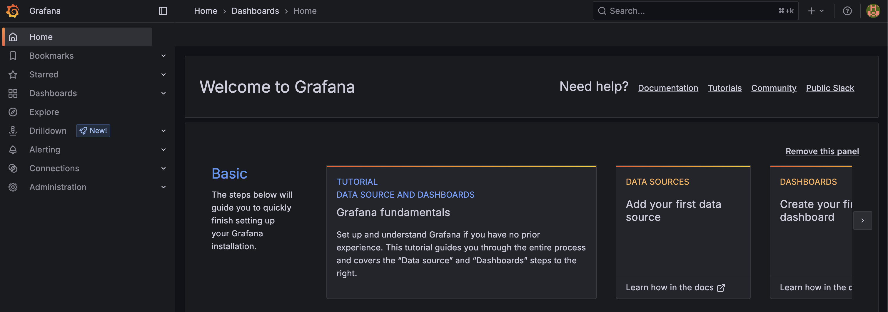

<h1>
  <span class="headline">Observability: Logs, Metrics, and Traces Lab</span>
  <span class="subhead">Setup</span>
</h1>

## Setup

In this setup lesson, you’ll install Prometheus and Grafana on your machine, two of the most widely used open-source observability tools. You’ll also clone a simple FastAPI application that we’ll instrument with metrics in the next lab.

### 🔧 **1. Clone the Starter Project**

We’ll be working with a simple FastAPI app with two routes. Clone it to your local machine:

```bash
git clone https://github.com/your-org/python-observability-starter.git
cd python-observability-starter
```

> **Note:** This project requires Python 3.9+ and a virtual environment. If you haven't already, create and activate one:

```bash
python -m venv venv
source venv/bin/activate  # On Windows: venv\Scripts\activate
pip install -r requirements.txt
```

### 📦 **2. Install Prometheus**

#### ➔ Mac (Homebrew)

```bash
brew install prometheus
```

#### ➔ Windows

1. Go to [https://prometheus.io/download](https://prometheus.io/download)
2. Download the Windows .zip file.
3. Extract it to a folder (e.g., `C:\prometheus`)
4. Run `prometheus.exe` from a terminal:

```bash
cd C:\prometheus
prometheus.exe --config.file=prometheus.yml
```

#### ➔ Linux (manual)

```bash
wget https://github.com/prometheus/prometheus/releases/download/v2.51.0/prometheus-2.51.0.linux-amd64.tar.gz
tar xvf prometheus-2.51.0.linux-amd64.tar.gz
cd prometheus-2.51.0.linux-amd64
./prometheus --config.file=prometheus.yml
```

### 📊 **3. Install Grafana**

#### ➔ Mac (Homebrew)

```bash
brew install grafana
brew services start grafana
```

#### ➔ Windows

1. Go to [https://grafana.com/grafana/download](https://grafana.com/grafana/download)
2. Download the Windows installer (.msi)
3. Follow the installation wizard
4. Start Grafana Server:

```bash
cd "C:\Program Files\GrafanaLabs\grafana\bin"
grafana-server
```

#### ➔ Linux (Debian/Ubuntu)

```bash
sudo apt-get install -y software-properties-common
sudo add-apt-repository "deb https://packages.grafana.com/oss/deb stable main"
wget -q -O - https://packages.grafana.com/gpg.key | sudo apt-key add -
sudo apt-get update
sudo apt-get install grafana
sudo systemctl start grafana-server
sudo systemctl enable grafana-server
```

## ✅ **Verify Setup**

- **Prometheus UI**: [http://localhost:9090](http://localhost:9090)
- **Grafana UI**: [http://localhost:3000](http://localhost:3000)
  - Default login: `admin / admin` (you’ll be prompted to change it)



<br>

### **Next Steps**

In the next section, you’ll:

- Instrument your FastAPI app to expose metrics
- Configure Prometheus to scrape them
- Visualize those metrics in Grafana
